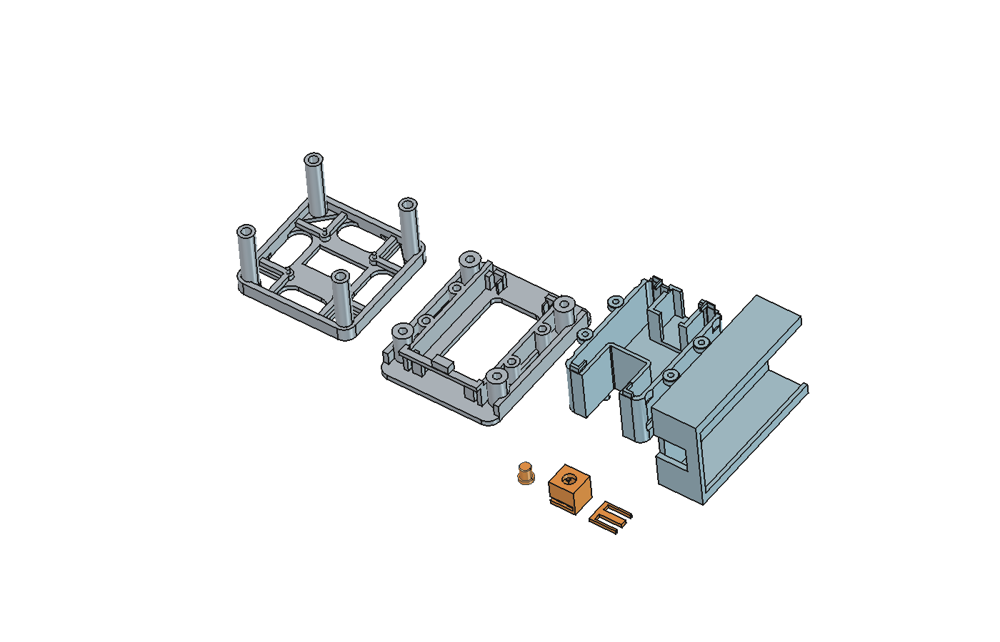
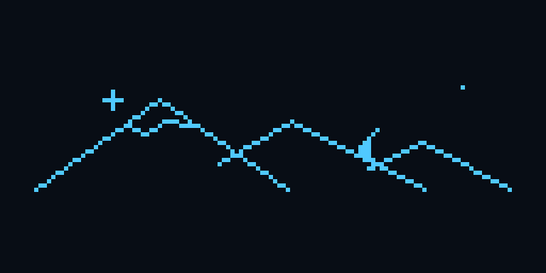
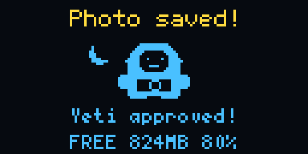
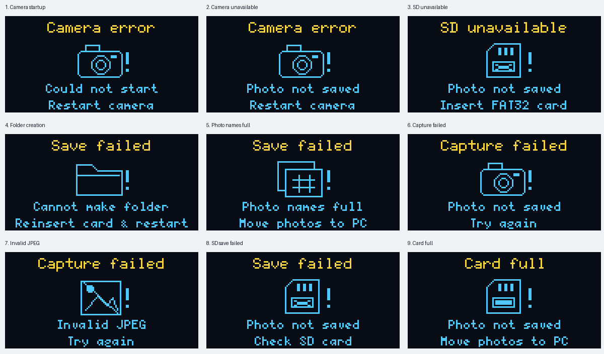

# ESP32 Sobel Camera

A small ESP32-S3 camera with an OLED screen and a shutter button. It saves color photos to a microSD card. The case has six printed parts, a removable button tray, and a slide-in battery holder mount.

The screen has three modes: **Normal**, **Combined Sobel**, and **Sobel + NMS**. Tap the button to take a photo. Hold it for about one second to change modes.



See [Sobel and Sobel + NMS](technical/edge-detection.md) for the algorithms, matrix examples, and code references.

## Before you build

- The firmware has been tested on the camera board listed below.
- USB power and the three-AAA battery setup have both been tested on this build.
- The case is a fit prototype. Measure your screen, switch, and battery holder before printing.
- The print files use millimeters. Print at **100% scale**.
- The files contain part geometry. Slice them for your own printer and material.

## What you need

| Part | Quantity | Details |
| --- | --- | --- |
| [Freenove FNK0085 ESP32-S3 camera board kit](https://store.freenove.com/products/fnk0085) | 1 | Use the 8 MB flash version with 8 MB PSRAM. The tested camera sensor is OV3660. |
| 0.96-inch SSD1306 OLED screen | 1 | 128 × 64 pixels. Four I2C pins: GND, VCC, SCL, SDA. See the [module reference](https://www.lcdwiki.com/0.96inch_OLED_Module_MC096VX). |
| Normally-open tactile button | 1 | The tray assumes a 6 × 6 mm switch, 4.3 mm total height, and 3.2 mm plastic body depth. These heights exclude the metal legs. |
| FAT32 microSD card | 1 | A 1 GB card was used for testing. |
| Female-to-female jumper wires | 4 | Short leads with 2.54 mm connectors for the screen. |
| Insulated wires for the button | 2 | With board-side female connectors. |
| USB data cable | 1 | Use the board's USB-UART port for upload and serial commands. |
| Regulated 5 V USB supply | 1 | Powers the camera after upload. |
| Switched three-AAA battery holder | Optional | The mount assumes a 63 × 37 × 16 mm body, excluding the switch. See the battery note below. |

The [Adafruit 367 switch](https://www.adafruit.com/product/367) is an example of the electrical type. Its listed height differs from the tray's 4.3 mm size. It is **not a confirmed fit**.

The OLED mounting reference is a 27.3 × 27.8 mm board. Its four 2 mm holes are spaced 23.3 × 23.8 mm apart, measured center to center. Similar-looking screens can have different sizes or pin orders.

### Screws and inserts

| Joint | Hardware | Holes in the design |
| --- | --- | --- |
| Screen body to camera base | Four M3 inserts and four M3 × 8 mm screws | Insert holes: 4 mm wide, 6 mm deep. Screw clearance: 3.4 mm. |
| Cable cover to camera base | Four M2 inserts and four M2 × 6 mm screws | Insert holes: 3.2 mm wide, 4.5 mm deep. |
| Button tray and backing key | Printed parts only | No screws or inserts. |
| Battery holder mount | Built into the cable cover | No screws or inserts. |

Tools: a 3D printer and slicer, small screwdrivers, calipers, a multimeter, wire cutters, and a soldering iron.

## Wiring

| Screen or button | ESP32-S3 pin |
| --- | --- |
| OLED GND | GND |
| OLED VCC | 3V3 |
| OLED SCL | GPIO42 |
| OLED SDA | GPIO41 |
| Button contact A | GPIO14 |
| Button contact B | GND |

The button connects GPIO14 to ground when pressed. The code uses the board's internal pull-up resistor.

The onboard microSD socket uses GPIO39, GPIO38, and GPIO40. The onboard RGB LED uses GPIO48. These pins are reserved.

### Power and the battery holder

For USB power, use a regulated 5 V supply through the USB-UART port.

The case has a mount for a switched three-AAA holder. Its reference size comes from [Pololu holder 1147](https://www.pololu.com/product/1147/specs). That holder is 63 × 37 × 16 mm; the switch adds 2 mm.

Three 1.5 V cells provide about 4.5 V in series.

## Install the firmware

The tested versions are:

| Software | Version |
| --- | --- |
| Arduino-ESP32 | 3.3.11 |
| U8g2 | 2.36.19 |
| JPEGDEC | 1.8.4 |

Use the [Arduino IDE](https://www.arduino.cc/en/software/).

1. Install [ESP32 board support](https://docs.espressif.com/projects/arduino-esp32/en/latest/installing.html), U8g2, and JPEGDEC by Larry Bank at the versions listed above.
2. Open [UsbCamera.ino](firmware/UsbCamera/UsbCamera.ino). Select **ESP32S3 Dev Module** and apply the settings below.
3. Upload through the **USB-UART** port.

| Setting | Value |
| --- | --- |
| Flash size | 8 MB |
| PSRAM | OPI PSRAM |
| Flash mode | QIO 80 MHz |
| USB CDC on boot | Disabled |
| Upload speed | 115200 |
| Serial Monitor baud | 115200 |

The ESP32 board package supplies the camera, Wire, SD_MMC, and JPEG metadata helpers. JPEGDEC is a separate library.

Flash the firmware.

## Print the case

Print one of each part:

| File | Purpose |
| --- | --- |
| [01-screen-body.3mf](printing/parts/01-screen-body.3mf) | Holds the OLED. |
| [02-camera-base.3mf](printing/parts/02-camera-base.3mf) | Holds the camera board. |
| [03-cable-cover.3mf](printing/parts/03-cable-cover.3mf) | Covers wiring and holds the button tray and battery cradle. |
| [04-shutter-cap.3mf](printing/parts/04-shutter-cap.3mf) | The part pressed by a finger. |
| [05-shutter-tray.3mf](printing/parts/05-shutter-tray.3mf) | Holds the cap and switch. |
| [06-shutter-backing-key.3mf](printing/parts/06-shutter-backing-key.3mf) | Slides into the tray to retain the switch. |

## Use the camera

1. Insert a FAT32 microSD card before turning on power.
2. Connect USB power. A three-second moon-and-mountains animation plays, then Normal preview starts.
3. Tap and release the shutter to take a photo. Hold the camera still until **Photo saved!** appears.
4. The LED flashes green after the save is checked. The screen shows a Yeti animation, a rotating caption, and free storage for about three seconds.
5. Wait for the preview to return. Disconnect power before removing the card.





| Button action | Result |
| --- | --- |
| Tap and release in less than 0.9 seconds | Save one photo. |
| Hold for about one second | Change preview mode once. Release before the next action. |
| Press while a photo is being captured or sent over USB | The press is ignored. |

Modes cycle as **Normal → Combined Sobel → Sobel + NMS → Normal**. The camera starts in Normal after a reset. The onboard BOOT button supports the same actions while the camera is running. Do not hold BOOT while powering on.

Photos are saved on the card as `/photos/IMG_000001.jpg`, then higher numbers. Existing names are skipped. Each new file is read back and checked before success is shown. The firmware does not format the card or remove old photos to make room.

### Preview and saved photos

- **Normal:** adjusts contrast and uses small on/off dots to show shading.
- **Combined Sobel:** shows edges whose strength reaches 75.
- **Sobel + NMS:** uses the same threshold, then keeps local peaks to make edges thinner.

The preview starts as a 640 × 480 JPEG frame. JPEGDEC turns it into a 320 × 240 grayscale image. The code rotates it, corrects left/right movement, and crops and resizes it to 128 × 64 for the OLED. The edge modes use 3 × 3 Sobel kernels and `abs(gx) + abs(gy)`. NMS compares two neighbors along the gradient direction.

All three modes save full-resolution **color** JPEGs.

The JPEG contains 1600 × 1200 pixels. EXIF Orientation 7 tells compatible viewers to show it upright as 1200 × 1600. A viewer that ignores EXIF will show the sensor's original orientation. The OLED shows a center crop, so saved photos contain more of the scene.

## Errors and troubleshooting



Error animations last about three seconds. The preview then returns if the camera is running.

| Message | What to do |
| --- | --- |
| Camera error | Restart the camera. Check its ribbon connector with power off. |
| SD unavailable | Power off. Insert a writable FAT32 card and restart. |
| Cannot make folder | Reinsert the card and restart. Check the card on a computer if it happens again. |
| Photo names full | Back up the photos and free numbered filenames on the card. |
| Capture failed / Invalid JPEG | Try again. Check the power supply if the error repeats. |
| Save failed / Check SD card | Check the card and USB power. A write or readback check failed. |
| Card full | Back up photos and free space on the card. |
| No OLED image | Check GND, 3V3, SDA41, and SCL42. The driver expects SSD1306 at 0x3C or 0x3D. |
| Button does nothing or stays pressed | Check its contacts with a meter. Check that the cap moves freely. |
| Upload fails | Use USB-UART and a data cable. Check the selected port. See the [board guide](https://docs.freenove.com/projects/fnk0085/en/latest/fnk0085/codes/C/Preface.html). |

The OLED has only 128 × 64 pixels. Use good light and move farther from the subject for a clearer preview. Blue/yellow OLED panels have fixed color bands; they do not display full-color images.

<details>
<summary>Optional serial commands</summary>

Use 115200 baud through USB-UART.

| Command | Action |
| --- | --- |
| `?` | Show camera, screen, preview, storage, and LED status. |
| `0`, `1`, `2` | Select Normal, Combined Sobel, or Sobel + NMS. |
| `v` | Cycle preview modes. |
| `s` | Save a photo to the card. |
| `m` | Check or mount the card. |
| `t` | Show the OLED test pattern for five seconds. |
| `e` | Show the card-full animation. No photo is saved. |
| `E` | Cycle through the nine error animations. No photo is saved. |
| `c` | Capture and send a color JPEG over serial. A receiver that can read binary data is needed. |
| `o` | Send the 1024-byte OLED buffer after a text header. A binary receiver is needed. |

</details>

## Project files

```text
esp32-sobel-camera/
├── README.md
├── LICENSE
├── THIRD_PARTY_NOTICES.md
├── .gitignore
├── firmware/
│   └── UsbCamera/
│       ├── UsbCamera.ino
│       ├── CameraOrientation.h
│       ├── PreviewDecoder.h
│       ├── PreviewFilter.h
│       ├── ShutterGesture.h
│       ├── StartupAnimation.h
│       ├── PhotoCelebration.h
│       └── ErrorAnimation.h
├── cad/
│   └── portable-camera.FCStd
├── technical/
│   └── edge-detection.md
├── printing/
│   └── parts/
│       ├── 01-screen-body.3mf
│       ├── 02-camera-base.3mf
│       ├── 03-cable-cover.3mf
│       ├── 04-shutter-cap.3mf
│       ├── 05-shutter-tray.3mf
│       └── 06-shutter-backing-key.3mf
└── design/
    └── previews/
        ├── print-layout.png
        ├── camera-startup.gif
        ├── yeti-photo-feedback.gif
        └── error-messages.png
```

Open [the CAD model](cad/portable-camera.FCStd) in FreeCAD to edit the case. It contains six printable bodies. Export the final feature of each body, called its **Tip**. Hidden earlier features record the build history. Some later changes are stored as solid shapes rather than editable sketches.

The main sketch handles the camera, card, button, and LED. `PreviewDecoder.h` decodes preview frames. `PreviewFilter.h` contains the three filters and threshold. `CameraOrientation.h` handles photo orientation. The other headers handle button timing and screen animations.

## License and credits

The original firmware, case design, print exports, and documentation use the [MIT License](LICENSE). You can use, change, share, and sell them. Keep the copyright and license notice.

External libraries and reference material keep their own licenses. See [THIRD_PARTY_NOTICES.md](THIRD_PARTY_NOTICES.md) for credits.
